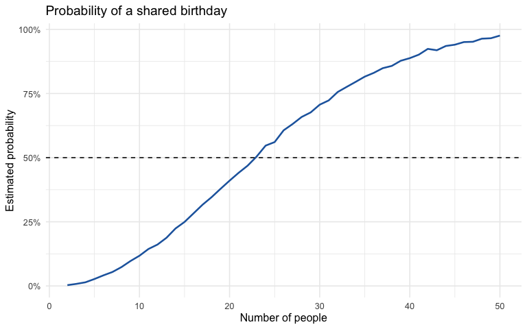
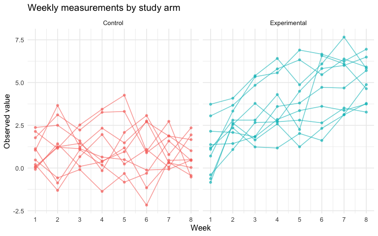
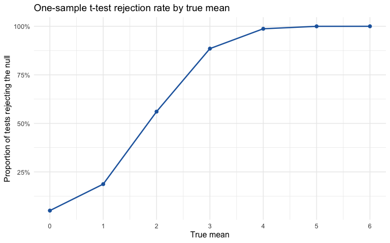
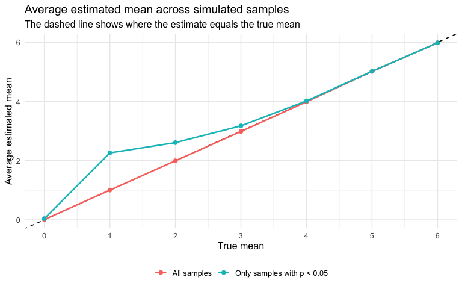

Homework 5
================
Songyao Wang

# Problem 1

``` r
shared_birthday = function(group_size) {
  birthdays = sample.int(365, size = group_size, replace = TRUE)
  anyDuplicated(birthdays) > 0L
}

set.seed(4154)

birthday_results =
  tibble(group_size = 2:50) |>
  mutate(
    probability = map_dbl(
      group_size,
      \(size) mean(replicate(10000, shared_birthday(size)))
    )
  )

ggplot(birthday_results, aes(x = group_size, y = probability)) +
  geom_line(color = "#2166AC", linewidth = 0.9) +
  geom_hline(yintercept = 0.5, linetype = "dashed") +
  scale_y_continuous(labels = scales::label_percent()) +
  labs(
    title = "Probability of a shared birthday",
    x = "Number of people",
    y = "Estimated probability"
  )
```

<!-- -->

As the group size increases, there are more pairs of people who could
share a birthday, so the probability that at least two people share a
birthday rises. In the simulation, this probability is close to 50% for
a group of 23 people.

# Problem 2

csv_paths = list.files(“data”, pattern = “\\csv\$”, recursive = TRUE,
full.names = TRUE) csv_paths names(readr::read_csv(csv_paths\[1\],
show_col_types = FALSE))

``` r
participant_files =
  tibble(
    path = list.files(
      "data",
      pattern = "^(con|exp)_[0-9]+\\.csv$",
      recursive = TRUE,
      full.names = TRUE
    )
  )

stopifnot(nrow(participant_files) > 0L)

longitudinal_data =
  participant_files |>
  mutate(
    participant = tools::file_path_sans_ext(basename(path)),
    arm = recode(str_extract(participant, "^[^_]+"),
                 con = "Control", exp = "Experimental"),
    subject_id = str_extract(participant, "[0-9]+$"),
    observations = map(path, \(file) read_csv(file, show_col_types = FALSE))
  ) |>
  select(participant, subject_id, arm, observations) |>
  unnest(observations) |>
  pivot_longer(
    cols = starts_with("week"),
    names_to = "week",
    names_transform = list(week = readr::parse_number),
    values_to = "value"
  ) |>
  arrange(arm, subject_id, week)

longitudinal_data |>
  distinct(arm, participant) |>
  count(arm)
```

    ## # A tibble: 2 × 2
    ##   arm              n
    ##   <chr>        <int>
    ## 1 Control         10
    ## 2 Experimental    10

``` r
ggplot(
  longitudinal_data,
  aes(x = week, y = value, group = participant, color = arm)
) +
  geom_line(alpha = 0.65) +
  geom_point(alpha = 0.65, size = 1.3) +
  facet_wrap(~ arm) +
  guides(color = "none") +
  scale_x_continuous(breaks = sort(unique(longitudinal_data$week))) +
  labs(
    title = "Weekly measurements by study arm",
    x = "Week",
    y = "Observed value"
  )
```

<!-- -->

Measurements in the control group does not show a clear overall trend.
In the experimental group, measurements generally increased over the
eight weeks, although the amount of change varied across participants.
By week 8, the experimental group had higher observed values than the
control group.

# Problem 3

``` r
simulate_t_test = function(true_mu) {
  sample_values = rnorm(n = 30, mean = true_mu, sd = 5)

  broom::tidy(t.test(sample_values, mu = 0)) |>
    select(estimate, p.value)
}

set.seed(4155)

simulation_results =
  tibble(true_mu = 0:6) |>
  mutate(
    results = map(
      true_mu,
      \(mu) map_dfr(seq_len(5000), \(simulation) simulate_t_test(mu))
    )
  ) |>
  unnest(results) |>
  mutate(rejected = p.value < 0.05)

simulation_summary =
  simulation_results |>
  group_by(true_mu) |>
  summarize(
    rejection_rate = mean(rejected),
    mean_all = mean(estimate),
    mean_rejected = mean(estimate[rejected]),
    .groups = "drop"
  )
```

``` r
ggplot(simulation_summary, aes(x = true_mu, y = rejection_rate)) +
  geom_line(color = "#2166AC", linewidth = 0.9) +
  geom_point(color = "#2166AC", size = 2) +
  scale_x_continuous(breaks = 0:6) +
  scale_y_continuous(labels = scales::label_percent()) +
  labs(
    title = "One-sample t-test rejection rate by true mean",
    x = "True mean",
    y = "Proportion of tests rejecting the null"
  )
```

<!-- -->

When the true mean was 0, the test rejected the null in about 5% of
simulations, close to the nominal Type I error rate. With the sample
size and standard deviation fixed, power increased as the true mean
moved farther from zero, rising from about 19% at a true mean of 1 to
89% at 3 and nearly 100% at 4.

``` r
estimate_plot_data =
  simulation_summary |>
  pivot_longer(
    cols = c(mean_all, mean_rejected),
    names_to = "sample_set",
    values_to = "average_estimate"
  ) |>
  mutate(
    sample_set = recode(
      sample_set,
      mean_all = "All samples",
      mean_rejected = "Only samples with p < 0.05"
    )
  )

ggplot(
  estimate_plot_data,
  aes(x = true_mu, y = average_estimate, color = sample_set)
) +
  geom_abline(intercept = 0, slope = 1, linetype = "dashed") +
  geom_line(linewidth = 0.9) +
  geom_point(size = 2) +
  scale_x_continuous(breaks = 0:6) +
  labs(
    title = "Average estimated mean across simulated samples",
    subtitle = "The dashed line shows where the estimate equals the true mean",
    x = "True mean",
    y = "Average estimated mean",
    color = NULL
  ) +
  theme(legend.position = "bottom")
```

<!-- -->

The average estimate across all simulated samples closely matched the
true mean. Among samples with statistically significant results, small
positive means were overestimated. For example, when the true mean was
1, the average estimate among significant results was about 2.3 because
samples with unusually large estimates were more likely to reject the
null. The two curves nearly overlapped at true means of 4 or higher,
where almost all tests rejected the null. At a true mean of 0, the
average among significant results stayed near zero because the two-sided
test selected extreme estimates in both directions.
